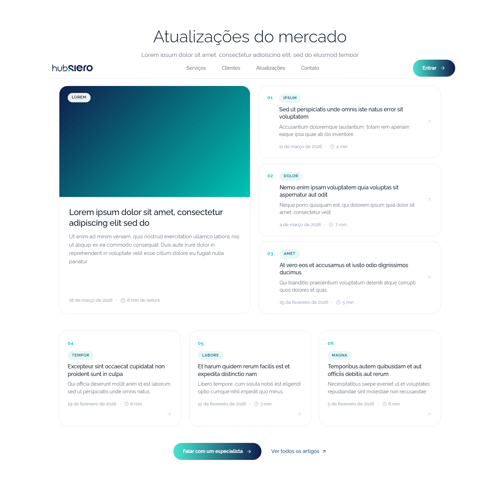

# Hub.Siero — seção "Atualizações do mercado"

A seção de conteúdo da landing do Hub.Siero, extraída como peça isolada.
Entra no site institucional **logo abaixo do vídeo do Hero**, antes das seções
de produto.

**Demonstração ao vivo:** https://bernardoblom123.github.io/Hub.siero-blog/



## O que é

Uma **chamada** para o blog, não uma segunda listagem. O desenho foge da grade
de três colunas das outras seções de propósito: um destaque alto à esquerda com
capa em gradiente, três chamadas numeradas empilhadas à direita e uma fileira de
três abaixo. Essa hierarquia editorial é o que distingue uma seção de conteúdo
de uma de serviços.

Ações no pé: **Falar com um especialista** (âncora `#contato`) como ação
principal, e **Ver todos os artigos** (rota `/blog`) como link secundário.

## Conteúdo é placeholder

Os sete itens são **lorem ipsum**, inclusive as categorias. Nada vem da API.

Para ligar ao backend, a fonte é o contrato `PublicArticle`
(`src/pages/site/blog/types.ts` na aplicação), e o endereço de cada cartão passa
a ser `/blog/:slug`. Os campos usados aqui mapeiam assim:

| Aqui        | `PublicArticle`              |
| ----------- | ---------------------------- |
| `titulo`    | `title`                      |
| `resumo`    | `excerpt`                    |
| `categoria` | `tags_list[0]`               |
| `data`      | `published_at`               |
| `leitura`   | `read_time`                  |

## Arquivos

Os caminhos em `src/` espelham os da aplicação, então os arquivos são coláveis
de volta sem ajuste de import.

```
src/pages/site/components/BlogSection.tsx   o componente
src/pages/site/blogSection.scss             os estilos da seção
src/pages/site/smoothScroll.ts              helper já existente no app, aqui
                                            só para a demonstração compilar

demo/index.html                             entrada da demonstração
demo/main.tsx                               a página de demonstração
demo/demo.scss                              estilos de apoio, NÃO vão para o app

index.html + assets/                        a demonstração COMPILADA, na raiz
.nojekyll                                   desliga o Jekyll do GitHub Pages
```

O build sai na raiz porque o GitHub Pages deste repositório está ligado com
origem `main` na raiz. Sem o `.nojekyll`, o Pages renderizaria o README como
site em vez de servir a página.

## Rodar a demonstração

```bash
npm install
npm run dev      # desenvolvimento
npm run build    # typecheck + build para a raiz (publica no Pages)
npm run preview  # serve o build
```

A página usa `MemoryRouter`: no GitHub Pages não existe rota `/blog` nem
fallback de SPA, então o link secundário é inerte na demonstração em vez de
levar a um 404.

## Como integrar

1. Copie `src/pages/site/components/BlogSection.tsx` para o mesmo caminho na
   aplicação. O `smoothScroll.ts` já existe lá; não copie o daqui.
2. Cole o conteúdo de `src/pages/site/blogSection.scss` no fim de `src/pages/site/site.scss`,
   **dentro** do bloco `.site-institucional` (sem repetir o wrapper), e acrescente
   `.blog-highlight` e `.blog-post-card` à lista do `@media (prefers-reduced-motion)`
   que já existe lá.
3. Monte a seção em `src/pages/site/index.tsx`, logo após `<Hero />`:

   ```tsx
   import BlogSection from "./components/BlogSection";

   <Hero />
   <BlogSection />
   <Features />
   ```

4. Opcional: adicione `{ label: "Atualizações", href: "#blog" }` ao `NAV_LINKS`
   de `src/pages/site/components/SiteHeader.tsx`.

### Dependências

`react-router-dom` (o `Link` para `/blog`), `lucide-react` (ícones `ArrowRight`,
`ArrowUpRight`, `Clock`) e o helper `scrollToAnchor` de `src/pages/site/smoothScroll.ts`.
Todos já presentes na aplicação.

## Paleta

Nenhuma cor nova foi introduzida: tudo sai de tokens já usados no site.

| Cor       | Onde                                  |
| --------- | ------------------------------------- |
| `#0f1d4b` | navy da marca, início do gradiente    |
| `#00c4b4` | teal do site, fim do gradiente        |
| `#0d1b2a` | escuro do site, títulos               |
| `#00d9bd` | teal do logo, só na textura de pontos |
| `#0b4a6e` | petróleo, chips e link secundário     |
| `#e6f8f6` | fundo do chip                         |
| `#e5e7eb` | borda; `#d9dee5` em hover             |
| `#6b7280` | texto de apoio; `#93a0b8` nos metas   |

O card repete o idioma do `.service-card` do site: raio 24px, borda `#e5e7eb`,
hover de `-4px` com `cubic-bezier(0.22, 1, 0.36, 1)`.

## Acessibilidade

Elementos decorativos (capa, separadores, setas, numeração) são `aria-hidden`.
O movimento de hover é desligado sob `prefers-reduced-motion: reduce`.

O `scroll-margin-top: 110px` existe porque o cabeçalho do site flutua sobre o
conteúdo; sem ele, o salto pela âncora `#blog` deixa o título por baixo. As
demais seções do site não têm essa folga e apresentam o mesmo comportamento.

## Pendências conhecidas

- Os cartões **não são links**. Têm `cursor: pointer` e afordância de clique,
  mas nada navega até que o conteúdo venha da API. Ao ligar, o título deve virar
  um link real para `/blog/:slug`.
- O destaque tem capa em cor, não imagem. Quando houver `image_url` no contrato,
  o gradiente vira o estado de fallback.
